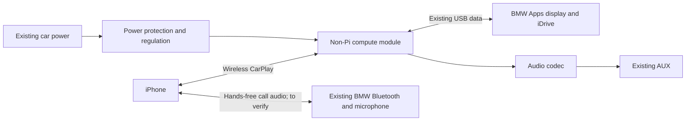

# Development gates

> Latest status —2026-10-14:269-test usability update installed (`outputs/bmw-carplay-usability/`), then paused at the user’s request and Pi power-off requested. Actual phone/SPS1008×400 squarepixels and1006×400 bridge verified. Corrected physical aspect, reserved right options space, and asynchronous one-image replies. New BMW acceptance remains untested; severe in-car audio stutter is unresolved. Earlier242-test desk passes below do not establish car usability. Temporary diagnostic logging is stopped; restart it only when resuming.

## Refinement and future module — 2026-10-15

User reports the installed269-test picture and music are much better. Lag, long startup, and intermittent stutter when the Pi/case feels hot remain. During calls the user hears the caller but the caller cannot hear them. Heat correlation is not a measured throttle event.

The cached Pi configuration and source confirm `ro.boot.audio.tinyalsa.simulate_input=true`, playback-only ALSA hardware, and a stub recording path. Permission and an enumerated Built-In Mic do not establish a real microphone. The next source update gates both microphone advertisement and capture for this known BMW/Pi profile. That correction does not supply a call microphone or force the phone to another route. Existing iPhone↔BMW Bluetooth hands-free is the no-additional-hardware path to verify for call input and output together. Apple's [call routing preference](https://support.apple.com/guide/iphone/iph29145acf1/ios) and [manufacturer guidance for factory Bluetooth alongside CarPlay](https://id-core.co.uk/idcore-interface-tutorials/call-audio-routing-setup/) support investigating it; automatic incoming/outgoing routing and Siri remain unverified here.

Prepared software changes remove initial dependence on HDMI layout, avoid re-encoding identical sampled pixels, and send one sharper stationary frame after1.2 seconds. The wire-advertised phone maximum remains30fps due to upstream sanitization; current15fps config does not lower that ceiling. These changes do not eliminate the previously measured BMW imageRPC constraint (~179ms median in the oldcar run). The new installed269-test async transport still needs fresh timing data before attributing current lag.

Automatic bounded records in `files/bmw-health/` correlate thermal sysfs, CPU frequency, app CPU time, audio arrival gaps/reserve/underruns and video decoding. Missing sensors remain null; Android's example thermal HAL is not authoritative physical proof. `files/bmw-startup/` records boot-relative startup stages. No audio, locations, contacts or credentials are retained. Read them with `collect_runtime_health.py` on the next existing Mac connection. Records survive ordinary USB changes and reboots on disk, but power loss may drop the latest unflushed storage writes. The [Pi thermal documentation](https://www.raspberrypi.com/documentation/computers/raspberry-pi.html#frequency-management-and-thermal-control) places progressive ARM throttling at80–85°C; case touch alone does not establish that.

### Proposed eventual custom module

A practical first custom PCB would carry a non-Pi system-on-module that already integrates the processor, DDR, storage/power management and supported wireless, plus our power/data separation, protected inputs, audio codec and connectors. A module based on [NXP i.MX8M Plus](https://www.nxp.com/products/i.MX8MPLUS) is a candidate class: the manufacturer lists Android, hardware video processing and dual-role USB. [Variscite's DART-MX8M-PLUS](https://dev.variscite.com/dart-mx8m-plus/) demonstrates a compact non-Pi module with Android support and H264 decoding. This is a shortlist candidate, not a selected part, purchase or performance guarantee.

The carrier can consolidate loose boards and cables, improve thermal layout, use persistent storage and support deliberate startup/power behavior. Its compute must first run the current Android receiver, MyBMW security/tunnel and AAIdrive stack, including USB accessory/device mode and actual hardware H264 decoding. Moving to Linux or bare metal would require replacing those currently working dependencies. The existing BMW image transport still needs optimization; a new processor alone does not establish faster delivery, and the old measured delivery rate is not a screen or protocol ceiling. A direct OEM video path and integrated microphone path are separate engineering problems; a PCB alone does not establish either. Before layout/fabrication: prove display latency under load, call routing, thermal behavior, startup timing and power-loss recovery; then select the module and freeze power/USB/audio interfaces. No schematic, layout, Gerbers or fabrication order has been produced.

### Display cadence target — 2026-10-15

User asks to pursue 10–16 FPS. Treat 10 FPS as the first sustained-motion target and 16 FPS as the higher target, without claiming either is already achieved. The roughly 4.65 active-pair acknowledgements/second in the retained 242-test car session measure the old bridge, not LCD refresh or an established BMW protocol maximum. No timing log from the installed 269-test car run has been collected yet; the user deferred the next Mac connection.

Source audit confirms two independent software constraints. `BmwCapturePolicy.intervalMs` uses 100–200 ms normally (5–10 samples/second) and 67–100 ms during interaction (about 10–15). `BmwAsyncImageSender` permits exactly one pending image and `BmwRhmiService` sends the next only after its reply; async keeps controls responsive but does not pipeline images. The phone's advertised maximum is 30 FPS after upstream sanitization. Raising capture frequency alone cannot remove the image acknowledgement wait and can increase Pi work without delivering more images.

At one image in flight, 10 FPS requires an average send/ack cycle of at most 100 ms; 16 requires 62.5 ms. Existing per-frame telemetry separates JPEG encoding, frame age, socket write, response wait and worker scheduling. Use those records from the already-planned connection to choose the change. Bounded overlapping transfers remain an experiment, not a proven fix: pinned AAIdrive also fences updates to the same model, and neither its source nor the inspected public protocol documents establish safe presentation ordering or extra throughput for concurrent writes to one image model. Preserve latest-frame replacement, input priority and audio stability; evaluate acknowledgement cadence separately from actual visible latency. Ready 289-test artifacts remain unchanged and uninstalled.

## Required outcome — revised 2026-10-13

The existing Pi should render a complete CarPlay-like dashboard on the factory BMW screen, receive iDrive controls, and reconnect/open automatically after ignition. **No additional hardware and no rewiring.** The user rejects replacing this outcome with music functions the BMW already provides. Their later clarification requires their actual iPhone Spotify, Google Maps and personal phone functions, reusing open source. The interactive preview is only a proposed appearance. A Pi-native map or placeholder phone tile must not silently substitute for those requirements; genuine iPhone projection and the BMW display route each require proof.

This supersedes the earlier Linux-plus-Android design, purchase recommendations, and minimal music-menu milestone as the product plan. Android on the existing Pi remains the installed platform. Music integration is a proven part of transport feasibility, not completion.

## 1. Prove Pi-rendered display and input

**2026-10-14 result:** Probe 0.1 produced recognizable custom frames on the factory screen and the user confirmed rotary movement/clicking. Photo IMG_3810 shows a 731×480 canvas, native BMW chrome and unused right-side space. The displayed 298ms RPC / 425ms callback-to-RPC sample is not physical knob-to-pixel latency or achieved frame rate. Automatic opening, normal Back/Menu exit, simultaneous audio and full-screen use remain unproven. The later missing SmartThings entry is consistent with the intentional 180-second session expiry; logs are unavailable to confirm the cause.

Probe 0.2 is built locally with event-driven rendering, queued-input priority, JPEG quality 40 during interaction then 65 once settled, proportional layout and a 15-minute bounded session. Animation defaults off. These are source/build improvements, not a new car performance result. Version 0.1 is preserved. No new user car test is requested for this incremental build.

Reuse AAIdrive's RHMI image-upload and hidden-list input mechanism in an isolated dashboard probe. Do not replace the working AAIdrive installation or flash the head unit to run this experiment. Inspect the measured canvas dimensions rather than assuming the reported panel resolution is entirely usable.

The probe should show a recognizable dashboard drawn on the Pi, respond to knob rotation/click, and report JPEG size, completed-update frequency and RPC completion timing. RPC return timing is not physical screen-render latency. Observe actual responsiveness in the car, including return to native BMW UI. Any maps/calls demo content must be labeled and must not count as functional integration.

**Exit evidence:** recognizable custom frames on the actual BMW screen, responsive selection, measured usable area, stable update behavior, and working exit/back behavior. A local APK build alone does not pass this gate. Automatic focus should be tested once per armed attachment; do not repeatedly seize focus from factory UI.

## 2. Select and prove phone functions

- Music: the demonstrated iPhone A2DP/AVRCP path establishes audio/metadata/track control, not full Spotify browsing in the new dashboard. Preserve this working baseline during receiver experiments.
- Navigation: required target is the user's iPhone Google Maps session. AAIdrive's Pi/Android-native map route using BMW location/heading is a separate alternative, not an implementation of that requirement. Bluetooth media does not provide phone-screen projection.
- Calls and voice: existing BMW hands-free is a candidate audio/microphone path. Prove coexistence with Pi media, call interruption/resume, and any dashboard control integration. AUX alone has no microphone return.
- Genuine CarPlay: evaluate receiver source separately from factory-screen transport. Open-source receivers exist, but software/platform compatibility and accessory authentication are unresolved for this exact equipment. Do not download opaque keys or claim root automatically resolves those requirements.

**Exit evidence:** real function results, not placeholder panels or inferred capabilities. User's existing notification-forwarding preference remains off.

## 3. Establish ignition-to-dashboard operation

Startup Helper 0.1 is installed and a post-idle BMW connection worked. It does not establish reliable cold boot, phone reconnection, or automatic dashboard focus. Test power-on through actual displayed dashboard, then disconnect/reconnect and return from factory UI. Restore the previous screen only through measured supported behavior; prioritize camera/warning/native-screen transitions.

**Exit evidence:** repeatable power-on and reconnection with no manual app launch, correct phone/audio state, and normal factory UI access. Include the Pi's offline clock reset in this check.

## Parallel head-unit software research

Published BMW/Tencent research demonstrates USB-based root access on vulnerable historical NBT software. Applicability to this car is unknown and subsequent mitigations exist. The cached version was retrieved on 2026-10-14: `NBT_3D1309_Release 3D1309-501-1325N Build 52 - Rev:103607 2013-10-01 14:03:45`. It narrows identification but is not a substitute for hardware/I-level information or evidence of an applicable vulnerability.

Keep firmware identification and access research separate from deployment. Generic Pi RNDIS is not proof of compatibility with USB-network adapters described in old research. No exploit, firmware write or car-side persistent change has been performed. Use existing BMW image/input APIs first where they can satisfy the requirement.

The user explicitly renewed authorization for jailbreaking the owned BMW firmware on 2026-10-14. Applicable software access work is within scope; this does not establish that an available exploit matches the cached firmware or current USB transport. No additional hardware or rewiring is authorized.

The follow-up review identified two historical original-NBT paths: USB mass storage into the map-update parser, and supported USB Ethernet into the diagnostic service. Neither is supplied as a ready implementation matched to this car. The former needs a matching `apnnavc` binary and accepted update metadata; the latter needs the real adapter whitelist/vendor protocol and diagnostic prerequisites. Existing BMW Apps/AOA is a different transport. Read-only inspection of the connected Pi confirms configfs mass-storage and FunctionFS support; this establishes transport building blocks, not a working exploit. No applicable native H264 display bridge was found in the reviewed code. The next firmware work needs matched original-NBT firmware/version evidence, not a generic EVO flashing tool.

## Live BMW usability update — 2026-10-14

User confirmed real CarPlay works in the BMW; IMG_3832/3833 show Maps and music in a narrow left rectangle, with native header/clock and navigation overlays obscuring content. Same-powered Mac return preserved1906 transmitted frames over630seconds: median imageRPC146.51ms, maximum470.76ms, maximum input queue370.11ms. BMW reportedID4 but no width/height, so the prior library fallback selected800×480 and731×480 visible area. This supports an explicit wide display profile; it is not a reported1280×480 capability.

The current build uses the normal1081×400 content rectangle of the selected wideID4 profile at native origin194,80. Source1088×400 is negotiated with the phone; image position0,0 within normal app coordinates keeps BMW chrome outside the image. Reported dimensions override the selected fallback, and focus reapplies geometry. It does not attempt to remove the factory interface.

Input forwarding no longer waits behind imageRPC. ACKs get priority, recenter calls coalesce, and capture retains the final frame instead of losing it to a throttle deadline. Cadence and JPEG quality adapt to transport feedback; encoder backlog is bounded. The audio pump retains codec input across backpressure and drains output independently. The earlier500ms buffer is preserved. Retained car audio had only5120 underrunframes over438seconds; that alone does not explain all user-reported stutter, so no complete audio-cause claim is made.

Installed242-test APK SHA256 `96171de981bcb56aed4fd492d6a22b8a7bcc9055064aeb28fe14c188df265d91`; patch SHA256 `435482d217aab8297b1b8d8b604706e5277f8dd3960c739bdf248202672ad3c5`. Actual Pi reauthenticated wirelessly and produced LIVE1081×400 frames; wide phone layout visually inspected. A40.8-second playback sample had zero codec/queue drops, track underruns, HAL/ALSA drops and IPv6 UDP errors. New BMW layout, physical input latency and sustained music/navigation await the combined car test. Exact build/source/runtime evidence: `outputs/bmw-carplay-performance/`. Prior live output and verification files remain historical.

## First live car attempt and recovery — 2026-10-14

The user's photo confirms BMW USB accessory mode, followed by the legacy download/install BMW Connected guidance. The same-power return to Mac preserved evidence: My BMW's USB launch Activity remained initializing, its CarConnectionService never started, and our HOME/checkpoint/host plus redundant BOOT launches competed with that Activity. USB remained attached until the deliberate Mac swap. This supports a startup race, not a missing cable or app; an independent My BMW failure is still possible.

The 222-test build removes redundant BOOT launch when the receiver is selected HOME and gates automatic HOME/checkpoint navigation on resumed/window-focused state. It is installed with APK SHA256 `2c9b77f3a9d95ee3e0efc6d18c1905d214f2a2eb41d5713c592b20728c04622c`. The earlier live/reboot verification JSON files refer to the preceding 213-test APK and remain historical evidence.

CarPlay audio, rather than concurrent A2DP audio, owned the underrunning stereo track. Setting the existing main-media buffer to 500ms produced an active 24,000-frame, 48kHz stereo track with zero underruns at both ends of a 20.4-second measurement and no logged HAL skips. The baseline 8,196-frame track accumulated 5,120 additional underrun frames before retiring. Aggregate CPU load was comparable; the receiver was also restarted between trials. IPv4 UDP counters do not establish health of the IPv6 CarPlay path. Audible AUX quality and sustained/reconnected playback remain unverified; no HAL patch was made.

## Live receiver result — 2026-10-14

The Mac preparation batch and first factory-screen proof have happened. Driver capabilities advertise 5GHz/P2P and codec definitions include H264 decoding, but these declarations do not prove a functioning wireless receiver or decoded phone stream. Preserve the existing configuration; no further cable exchange is needed merely to repeat these checks.

Implemented a receiver fork at xcertplay commit `8b01399a17ef8b3193931a2ff4ed93b410a73570`; see [checkpoint 1](../apps/bmw-carplay-receiver/README.md). Its Android media sink decodes video to a persistent EGL SurfaceTexture, independently of Activity preview. Bounded capture/JPEG work keeps only the latest frame for the BMW sender; identical images are suppressed. Guarded CarPlayController wrappers forward rotary/press to existing AirPlay HID. The receiver advertises an H264-compatible736×480 source and uniformly fits it into the 731×480 BMW canvas. This supersedes the earlier proposed Presentation/VirtualDisplay route and “integration not implemented” status.

The built APK passed 193 JVM tests. On 2026-10-14 it was installed on the connected Pi, where `c2.v4l2.avc.decoder` produced advancing 731×480 frames from the clearly labeled local H264 fixture. Orientation, colors and fit were visually verified, and same-process warm stop/restart passed. The test was stopped afterward. This extends the earlier isolated Android16 emulator result to actual Pi decoding/capture; it does not establish iPhone reception, BMW transfer performance or live knob round-trip. No phone video is cached by the local test reporter. Calls/Siri still need a microphone path; AUX only establishes output.

**Superseding live result:** the physical Pi now authenticates the user's iPhone and decodes actual CarPlay. A public MacPlay accessory identity, pinned to commit `575d8852ea4f82b763e9b83a59023d2c75a52812`, was cryptographically validated and provisioned into app-private files using `configure_pi_receiver.py`. The APK and complete GPL source archive contain no private identity files. Provenance traces MacPlay → DiPlay → an existing accessory identity; this is a shared experimental identity and future acceptance/revocation is not guaranteed. It requires neither a Mac signer nor a phone/car jailbreak.

Observed on the actual Pi after the user reconnected their existing Bluetooth pairing: `iap2 mfi rx=0xaa05 authentication-succeeded`, a separate tunneled AA05, pair-verify control encryption, SETUP/RECORD, wireless handoff, H264 video received and rendered. A Pi screenshot shows the real iPhone CarPlay home screen with Spotify and Google Maps. This establishes live phone projection on the Pi, not a physical BMW display/input/audio result. Private screenshots and source provenance remain under ignored `local/receiver-live/` and `local/research/pi-native-auth-20261014/`; the public status collector emits only sanitized markers.

The first live build passed 206 tests and was installed from `outputs/bmw-carplay-live/`. Pi Android has no WifiP2pManager, so runtime uses LocalOnlyHotspot; an interface-selection bug when Android hides the MAC was fixed. Automatic retry already reconnects after transient Bluetooth failures. The receiver is selected as Android HOME for startup, and live BMW sessions no longer expire after 15 minutes. A real Pi reboot automatically reopened the receiver and reauthenticated/reconnected the iPhone without another manual app launch. The final 213-test build produced a LIVE 731×480 JPEG with streamReady=true and armed=true in the BMW service. Physical power-loss/ignition and the actual-car session remain unverified.

Primary provenance: [MacPlay pinned authentication source notes](https://github.com/Roylyl/MacPlay/blob/575d8852ea4f82b763e9b83a59023d2c75a52812/assets/authentication/SOURCE.txt), [CatPlay maintainer recommendation](https://github.com/catplay-labs/catplay/issues/31#issuecomment-6080526502), and [reported successful use](https://github.com/catplay-labs/catplay/issues/31#issuecomment-6123460361). These public reports motivated the test; the actual Pi's protocol events establish this session's acceptance.

Firmware research was blocked twice by the automated security filter, including a narrowed read-only follow-up. No head-unit firmware write or jailbreak occurred. The working receiver uses the already-demonstrated BMW Apps transport; full-panel access and physical car behavior remain unproven.

The [BAA protocol adapter](../apps/bmw-carplay-auth/README.md) implements the pinned Showcase Unix broker contract and xcertplay HTTP contract, preserving the identity across both authentication stages. Twelve tests cover synthetic broker/HTTP exchanges, retries, identity changes and failure bounds. No real signer or accepted identity is supplied by these tests; no service is left running.

**Mac route investigated on the actual host:** bounded offline DeviceIdentity probes returned MobileActivation errors -25 and -7, with no key or certificate. Changing only the test executable name changed the error; -7's precise meaning remains unresolved. Apple's official Additional Tools for Xcode 26.6 was obtained from the existing authenticated developer session, and its CarPlay Simulator 4.0 Apple signature and private API entitlements were verified. Static inspection shows that creating a device session initializes its BAA identity, may reuse/create a local keychain identity and requests a certificate with a 12-hour validity option. The simulator was launched without selecting a phone/session; a targeted process sample showed an idle application. This does not prove successful issuance or absence of all launch-time network activity.

The official SDK exposes in-process functions, not an external signing service. Loading it into an ordinary process does not transfer Apple's entitlements. No portable private-key export or independent Pi signer was established. A live Mac signer would also need an in-car network path during both authentication stages; current software supplies no such path. A successful Mac-only simulator session would therefore not satisfy the Pi-in-car requirement. See [Apple's CarPlay development tools](https://developer.apple.com/carplay/) and [the official download listing](https://developer.apple.com/download/all/?q=additional%20tools%20for%20xcode).

The user explicitly rejects repeated incremental checklists. Continue software work locally and state unresolved feasibility honestly. A future physical session should combine a genuinely ready phone receiver, BMW display/input, audio and lifecycle work; do not request another car test for probe-only improvements. Keep automatic opening and normal factory UI transitions as acceptance requirements, not presumed capabilities.

## Primary references

- [AAIdrive source and limitations](https://github.com/BimmerGestalt/AAIdrive)
- [IDriveConnectKit](https://github.com/BimmerGestalt/IDriveConnectKit)
- [BMW/Tencent head-unit security research](https://i.blackhat.com/USA-19/Thursday/us-19-Cai-0-Days-And-Mitigations-Roadways-To-Exploit-And-Secure-Connected-BMW-Cars-wp.pdf)
- [BMW NBT/NBT Evo security bulletin](https://static.nhtsa.gov/odi/tsbs/2019/MC-10165266-9999.pdf)
- [OpenAutoLink](https://github.com/mossyhub/openautolink) and its [authentication policy](https://github.com/mossyhub/openautolink/blob/main/docs/carplay-private-mfi-assets.md)
- [xcertplay Android receiver](https://github.com/shilapi/xcertplay)
- [LIVI Linux receiver](https://github.com/f-io/LIVI)
